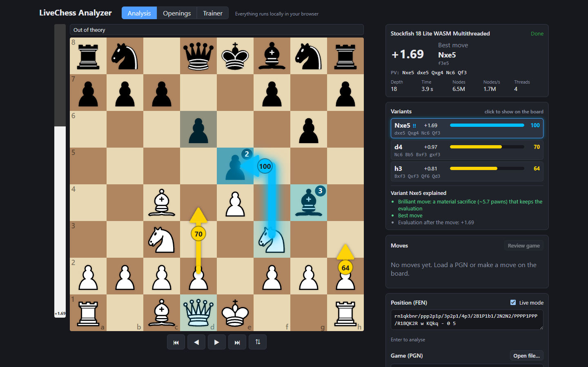
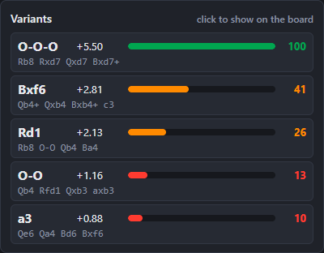
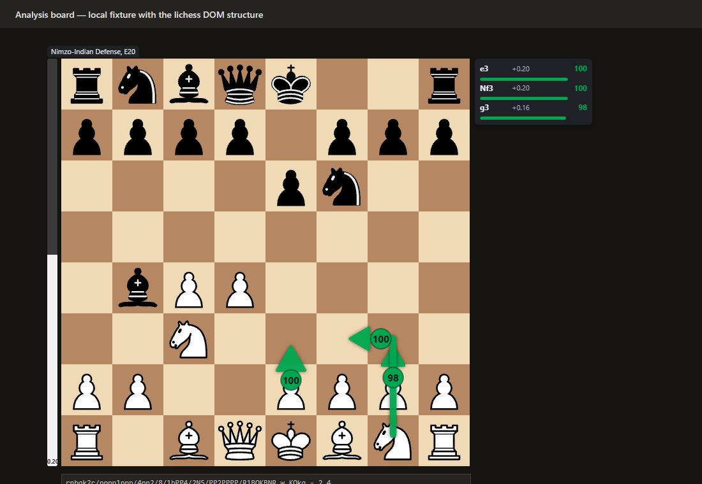
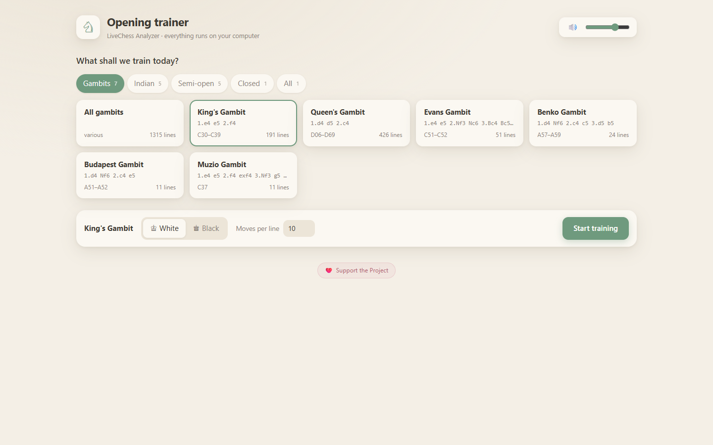
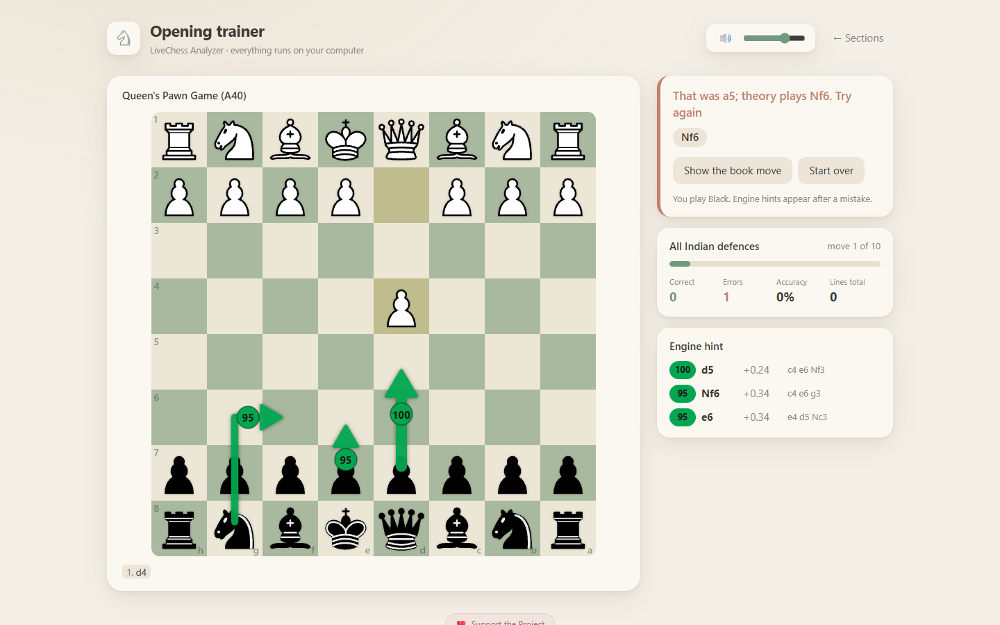

# LiveChess Analyzer

Local chess analysis with Stockfish 18 (WASM): a MultiPV analyzer with 0–100 move scores, an opening explorer and trainer, and a Chrome extension that works **only against bots and on analysis pages**.

[](https://github.com/sponsors/Vladnoflip)
[](https://github.com/Vladnoflip/live-chess-analyzer/actions/workflows/ci.yml)
[](LICENSE)
[](tsconfig.json)
[](extension/manifest.ts)

Everything runs on your machine. The engine is Stockfish compiled to WebAssembly and runs in a Web Worker; there is no server and no network traffic. The interface is available in English and Russian.

Repository: `https://github.com/Vladnoflip/live-chess-analyzer`

## Screenshots

**Analyzer.** MultiPV arrows with a 0–100 badge next to each arrow; the selected brilliant move (blue) with its first PV moves numbered on the board and a text explanation.



**Variants panel.** MultiPV 5 in Morphy's Opera Game before 12.O-O-O: the score bars use the colour steps (dark green 100, orange 44 / 27, red 17 / 10).



**Extension overlay** on an analysis board: eval bar, opening indicator ("Nimzo-Indian Defense, E20"), candidate arrows with badges and the compact variants panel. Captured on a local page that reproduces the lichess analysis-board DOM (the real sites block automated browsers).



**Trainer site** (a page inside the extension): sections grouped into tabs (here *Gambits*), each card with its move order, ECO range and number of book lines; then a training position after a wrong move, with feedback and engine hints.





The screenshots are produced by `npm run screenshots` (Puppeteer).

## Fair Play & Legality

> **This project is not a cheat.** Please read this section before installing the extension.

- The Chrome extension works **only** against chess.com bots (`chess.com/play/computer`) and on analysis pages (`chess.com/analysis`, `lichess.org/analysis`).
- It does **not** run during games against human players. The page whitelist and the board-ID check are hard-coded guards in [`extension/platforms/`](extension/platforms/), not settings, and cannot be bypassed through the UI:
  - on chess.com, the URL path **and** the board element id must match (`/play/computer` ↔ `#board-play-computer`, `/analysis` ↔ `#board-analysis-board`);
  - on lichess.org, only `/analysis` pages are accepted;
  - on every other page (`/game/live/…`, `/play/online`, lichess game pages, TV) the content script stays idle: no overlay, no engine request. The guard is covered by unit tests and by the end-to-end suite.
- It makes **no network requests**. All analysis is done locally by Stockfish WASM in an offscreen document (the trainer page runs its own engine worker). The opening book ships inside the extension bundle.
- It is not intended for use in rated or casual games against humans. Such use would violate the fair-play rules of chess platforms and could lead to account bans.
- Users are responsible for complying with the terms of service of chess.com and lichess.org.

Extension permissions: `storage` (settings) and `offscreen` (engine host), plus host access to `https://www.chess.com/*` and `https://lichess.org/*` only.

## Features

- **Real-time analysis.** Paste a FEN in *Live mode* and the position is re-analysed 400 ms after the last edit. You can also load a PGN, step through games, or make moves on the board by dragging or clicking; pieces slide when moves are played.
- **MultiPV 1 / 3 / 5.** Ranked candidate lines with evaluation, PV and depth. Every candidate has its own arrow; clicking a variant accents it and numbers its first three PV moves on the board.
- **0–100 move scores** based on the loss of win probability against the best line (Lichess win-% formula), shown in a badge next to each arrow, in the variants panel and for every move of a reviewed game.
- **Colour steps** for arrows and score bars: red → orange → yellow → green → dark green, and blue for brilliant moves.
- **Text explanation of a move**, built from heuristics on top of engine lines and chess.js (no language model): best / only move, missed mate, material loss or sacrifice (static exchange evaluation), king safety, piece mobility, opening theory.
- **Opening book**: the complete lichess-org/chess-openings set (CC0): 3,865 named lines covering all 500 ECO codes A00–E99. Positions are looked up by position, so transpositions count as theory.
- **Opening explorer**: search with autocomplete. Type "Najdorf", "Evans", "B90" or Russian words such as «Найдорф», and the chosen line is played on the board. A collapsible name tree goes from family to variation to sub-variation (Sicilian Defense → Najdorf Variation → English Attack); the path to the current opening opens automatically. Book moves can be filtered by ECO range, name and side.
- **Opening trainer** with 19 sections in tabs: *Gambits* (King's, Queen's, Evans, Benko, Budapest, Muzio and all gambits), *Indian* (Nimzo-Indian, King's Indian, Queen's Indian, Grünfeld and all Indian defences), *Semi-open* (Sicilian, French, Caro-Kann, Alekhine, Scandinavian), *Closed* (Slav) and *All*. Every section shows how many book lines it trains (see [Trainer sections](#trainer-sections)). Any book move counts as correct. Progress — the current line and lifetime statistics per section — is saved in `localStorage` and restored when you reopen the trainer.
- **Standalone trainer site** inside the extension, opened from the popup. It has a soft paper-and-sage theme with automatic dark mode and the cburnett pieces used by lichess.

### Where trainer progress is stored (not synchronized)

The trainer exists in two builds that share the same code (`src/core/drill.manager.ts`, storage key `livechess.drill.v1`):

| Build | Trainer entry point | Progress storage |
|---|---|---|
| Web app (`dist/`) | *Trainer* mode inside `index.html` (there is no separate `trainer.html`) | `localStorage` of the site's origin, e.g. `http://localhost:5173` or the GitHub Pages URL |
| Extension (`dist-extension/`) | `extension/trainer.html`, opened from the popup | `localStorage` of `chrome-extension://<extension id>` |

**Progress is not synchronized between the web app and the extension.** Browsers isolate `localStorage` per origin, so each build keeps its own line and statistics. The same applies to different web origins: the dev server, `npm run preview` and GitHub Pages each have their own progress. Sharing progress would need either a server or extra extension permissions on the web app's origin, and the project deliberately has neither: there are no network requests and only the chess.com and lichess.org host permissions.

The extension's own settings (overlay, depth, font, language, etc.) are a separate store in `chrome.storage.sync`. The trainer page reads the font and language settings from there. The web app keeps its language choice in `localStorage` (`livechess.locale.v1`).
- **Bilingual UI: auto-detects system language (English/Russian) with manual override.** A Russian system language (`navigator.language`) gives the Russian UI; any other language gives English. You can override this under *Engine settings → Language* in the web app and in the extension popup (*Language*). All texts live in `src/locales/en.json` and `src/locales/ru.json`.
- **Move sounds**, synthesized with Web Audio (no audio files).
- **Chrome extension (Manifest V3).** Eval bar, candidate arrows with score badges, a variants panel, the opening indicator, a "hints only on my turn" option, a depth cap, a font family and text size setting, and a language setting.

## Demo / How to use

**Web app** (`npm run dev`, then open http://localhost:5173):

1. **Analysis**: paste a FEN or a PGN and watch the eval bar, the arrows and the variants panel. Click a variant to see its explanation. Press *Review game* to score every move of a loaded game.
2. **Openings**: walk the opening tree. Each book move shows its name and ECO code.
3. **Trainer**: pick a section and a colour, then play the book moves by dragging or clicking.

The UI language follows your system; change it under *Engine settings → Language*.

**Extension:**

1. Open the popup to choose the number of variants, the depth cap, the font, and other options.
2. Open `chess.com/analysis`, `lichess.org/analysis` or a game against a chess.com bot. On any other page nothing happens.
3. Click *Open the opening trainer ↗* in the popup to open the trainer site.

## Installation

Prerequisites: Node.js 20 or newer, and Google Chrome (or another Chromium-based browser) for the extension.

```bash
npm install
```

| Command | What it does |
|---|---|
| `npm run dev` | Dev server at http://localhost:5173 (sends the COOP/COEP headers needed for the multi-threaded engine) |
| `npm run build` | Typecheck and build the web app into `dist/` |
| `npm run preview` | Serve `dist/` locally |
| `npm run build:extension` | Build the unpacked extension into `dist-extension/` |
| `npm test` | Unit and integration tests (Vitest; the integration tests run the real Stockfish WASM in Node) |
| `npm run test:extension` | Build the extension and run the end-to-end suite in Chrome for Testing (Puppeteer) on local fixture pages |
| `npm run screenshots` | Re-capture `docs/screenshots/` (needs `npm run build` and `npm run build:extension` first) |
| `npm run build-openings` | Regenerate `src/data/openings/openings.json` from the TSV files |

Puppeteer's install script downloads Chrome for Testing (~150 MB) into the user cache (`~/.cache/puppeteer`), outside the repository. If your npm is configured to skip install scripts, run `npx puppeteer browsers install chrome` once. The Stockfish WASM files are copied from `node_modules` into `public/engine/` by `npm run copy-engine`, which runs automatically before `dev` and `build`.

## Loading the extension

1. Run `npm run build:extension`.
2. Open `chrome://extensions`.
3. Turn on **Developer mode** (top right).
4. Click **Load unpacked** and select the `dist-extension/` folder.

After a rebuild, press the reload icon on the extension card.

## Project structure

```
src/
  services/         engine.service (UCI over a transport, MultiPV, cancellation), engine.transport (Web Worker),
                    uci.parser, board.service (chess.js wrapper: FEN, legal moves, SAN/UCI, PGN, SEE), sound.service
  core/             analysis.manager (state, cache, candidates, explanations), move-score, candidates,
                    move-explainer, classification, openings, opening.explorer, drill.manager, i18n,
                    arrow-geometry, piece-tracking, observable (Store / Emitter)
  components/       React UI only: Board, EvalBar, VariantsPanel, MoveList, DrillPanel, OpeningExplorerPanel, …
  locales/          UI dictionaries: en.json and ru.json (same keys, checked by TypeScript and tests)
  data/openings/    lichess-org/chess-openings TSV files (CC0) and the generated openings.json
  assets/pieces/    cburnett SVG pieces (GPLv2+)
extension/
  manifest.ts       Manifest V3 (storage + offscreen, chess.com and lichess.org only)
  background.ts     service worker: message routing, result cache, offscreen document lifecycle
  offscreen.ts      hosts Stockfish (the same EngineService as the app)
  content/          board polling, debounce, overlay (closed shadow DOM)
  platforms/        per-site DOM readers and the fair-play page guards
  trainer/          standalone trainer site (React)
  popup.*           settings
tests/              Vitest unit and integration tests, jsdom fixtures, a real Stockfish log
scripts/            copy-engine, build-openings, verify-extension (e2e), screenshots
docs/screenshots/   images used in this README
```

The service layer is framework-free. React components only read state through `useSyncExternalStore` and call methods. The app and the extension share `engine.service`, `board.service`, the scoring modules and the opening book.

## Trainer sections

Each section is a filter over the book: an ECO range **and** the family name. The name check keeps out stray lines that share an ECO code, such as the Van Geet Opening in C30–C39 or the Pseudo Queen's Indian in A47. Line counts refer to the bundled book (commit `3ba6b20`).

| Tab | Section | ECO | Name filter | Lines | Default side |
|---|---|---|---|---|---|
| Gambits | King's Gambit | C30–C39 | King's Gambit | 191 | White |
| Gambits | Queen's Gambit | D06–D69 | — (QGD, QGA, Slav and Semi-Slav lines) | 426 | White |
| Gambits | Evans Gambit | C51–C52 | Evans | 51 | White |
| Gambits | Benko Gambit | A57–A59 | Benko | 24 | Black |
| Gambits | Budapest Gambit | A51–A52 | Budapest | 11 | Black |
| Gambits | Muzio Gambit | C37 | Muzio | 11 | White |
| Gambits | All gambits | — | Gambit | 1315 | White |
| Indian | Nimzo-Indian Defence | E20–E59 | Nimzo-Indian | 104 | Black |
| Indian | King's Indian Defence | E60–E99 | King's Indian Defense | 119 | Black |
| Indian | Queen's Indian Defence | E12–E19 | Queen's Indian Defense | 73 | Black |
| Indian | Grünfeld Defence | D70–D99 | Grünfeld | 82 | Black |
| Indian | All Indian defences | A45–E99 | Indian Defense | 385 | Black |
| Semi-open | Sicilian Defence | B20–B99 | Sicilian Defense | 400 | Black |
| Semi-open | French Defence | C00–C19 | French Defense | 212 | Black |
| Semi-open | Caro-Kann Defence | B10–B19 | Caro-Kann | 110 | Black |
| Semi-open | Alekhine Defence | B02–B05 | Alekhine | 56 | Black |
| Semi-open | Scandinavian Defence | B01 | Scandinavian | 45 | Black |
| Closed | Slav Defence | D10–D19 | Slav Defense | 52 | Black |
| All | Overview | A00–E99 | — | 3865 | White |

Notes on the ranges:
- The Queen's Indian proper is E12–E19. E00–E11 is the Catalan and the Bogo-Indian.
- In the lichess book, the Budapest is named "Indian Defense: Budapest Gambit".
- The Muzio section means the King's Gambit Accepted lines. The Vienna "Hamppe-Muzio" (C25) is a different opening.

## How move scoring works

All formulas live in pure, unit-tested modules ([`src/core/move-score.ts`](src/core/move-score.ts), [`src/core/candidates.ts`](src/core/candidates.ts)).

**1. Win probability** (Lichess formula), with `cp` from White's point of view:

```
W(cp) = 50 + 50 · (2 / (1 + e^(−0.00368208 · cp)) − 1)        → 0..100
```

A forced mate counts as 100 for the side that mates and 0 for the side that gets mated.

**2. Loss against the best line**, in percentage points (pp), from the moving side's perspective:

```
delta = W_mover(best line) − W_mover(candidate)        (never below 0)
```

**3. Score 0–100**: piecewise-linear interpolation between these anchors, rounded.

| delta (pp) | 0 | 2 | 5 | 10 | 15 | 20 | 30 | ≥ 40 |
|---|---|---|---|---|---|---|---|---|
| score | 100 | 90 | 75 | 55 | 40 | 25 | 10 | 0 |

The best move always scores 100. An inaccuracy (10–20 pp) lands between 55 and 25, a mistake (20–30 pp) between 25 and 10, and a blunder (30+ pp) between 10 and 0.

**4. Colour steps** for arrows, badges and score bars:

| score | < 25 | 25–49 | 50–74 | 75–89 | ≥ 90 | brilliant |
|---|---|---|---|---|---|---|
| colour | red `#ff3b30` | orange `#ff8a00` | yellow `#ffd400` | green `#2fe06f` | dark green `#00a650` | blue `#00bfff` with a glow |

**5. Brilliant flag.** A move is brilliant when all of the following hold:
- it is the engine's best move;
- it puts at least 200 cp of material at risk, measured as `max(−SEE(move), best capture for the opponent afterwards)` with static exchange evaluation over legal moves;
- the mover keeps at least +0.50 or a forced mate afterwards.

**Example** (Stockfish 18 lite, MultiPV 3), Legal's mate: 1.e4 e5 2.Nf3 d6 3.Bc4 Bg4 4.Nc3 g6.
- **5.Nxe5!!** is the best move at +1.66, and it leaves the queen en prise (the opponent's best capture gains 570 cp). It is flagged brilliant and drawn blue.
- **5.d4** evaluates to +1.04: delta 5.36 pp, score **74**, a green arrow.

**Counter-example**: 4.Nxe5? in the Blackburne–Shilling trap (1.e4 e5 2.Nf3 Nc6 3.Bc4 Nd4) is not a sacrifice by SEE, since it just wins a pawn. The engine scores it as an error: +1.09 before, −0.72 after 4…Qg5! at depth 20.

## Tech stack

- **Language and build:** TypeScript (strict, no `any`), React 18, Vite 5.
- **Engine and rules:** Stockfish 18 lite WASM (stockfish.js), single- or multi-threaded depending on cross-origin isolation; chess.js 1.4.
- **Extension:** Chrome Manifest V3 with a service worker, an offscreen document and a content script with a closed shadow DOM, built with `@crxjs/vite-plugin`.
- **Testing:** Vitest with jsdom; Puppeteer with Chrome for Testing for the extension end-to-end suite.
- **Data:** lichess-org/chess-openings and cburnett pieces.

## Limitations

- **Castling rights in the extension** are inferred from the position (king and rooks on their original squares). The page shows no castling history, so a king or rook that moved and came back is misread. Move counters are not visible either and are set to `0 1`.
- **Site layout dependence.** The extension reads the board from the chess.com and lichess DOM (class names, `transform` offsets, board element ids). A redesign can break reading; in that case the overlay simply does not appear. Only `extension/platforms/*.ts` needs updating.
- **chess.com A/B tests** can serve different markup or board ids to different users. Because the bot/analysis guard requires a known board id, an unexpected variant makes the extension stay idle rather than run.
- **lichess support** is limited to the analysis board (`/analysis`). lichess games against the computer are not enabled.
- **End-to-end tests run on local fixture pages** that reproduce the sites' board DOM, because the real sites block automated browsers. Behaviour on the live sites is not covered by automated tests.
- **Engine strength.** The lite WASM builds are much weaker than native Stockfish, though far stronger than any human. The multi-threaded build needs COOP/COEP headers: the dev/preview servers and extension pages have them, but GitHub Pages does not, so the Pages deployment runs single-threaded.
- **Trainer progress is per build and per origin.** The web app and the extension do not share it; see [Where trainer progress is stored](#where-trainer-progress-is-stored-not-synchronized).
- **Promotion** by click or drag always promotes to a queen; under-promotions in loaded PGNs are handled correctly.
- **Languages.** The UI is in English and Russian only. Opening names come from the lichess book and are always in English.

## Contributing

See [CONTRIBUTING.md](CONTRIBUTING.md). For security issues, see [SECURITY.md](SECURITY.md). Release history is in [CHANGELOG.md](CHANGELOG.md).

## Support the Project

LiveChess Analyzer is built in spare time, out of enthusiasm for chess and open source. It is and will stay **completely free** under GPL-3.0: no paid features, no ads, no accounts. If it helps you, you can support further development:

- **GitHub Sponsors:** https://github.com/sponsors/Vladnoflip (also the *Sponsor* button at the top of this repository).
- **Ko-fi:** the link will be added here once the page is set up.

The web app footer, the extension popup and the trainer page each have a small *❤️ Support the Project* link. It is an ordinary link that opens in a new tab when you click it: no extra extension permissions, and the app and the extension still make no network requests of their own.

## License & Acknowledgements

LiveChess Analyzer is licensed under the **GNU General Public License v3.0** ([LICENSE](LICENSE)), because it bundles Stockfish.

- [Stockfish](https://github.com/official-stockfish/Stockfish) and [stockfish.js](https://github.com/nmrugg/stockfish.js): GPL-3.0.
- [chess.js](https://github.com/jhlywa/chess.js): BSD-2-Clause.
- [lichess-org/chess-openings](https://github.com/lichess-org/chess-openings): CC0-1.0.
- cburnett chess pieces by Colin M. L. Burnett, from [lichess-org/lila](https://github.com/lichess-org/lila): GPLv2+.
- The win-probability curve is the one published by Lichess.

Exact versions, paths and sources are listed in [LICENSE-NOTICE.md](LICENSE-NOTICE.md).
